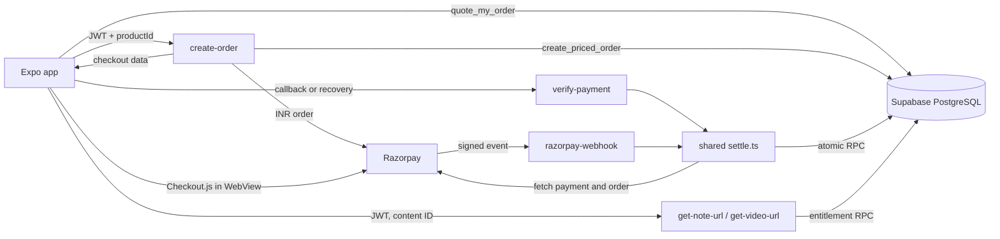

# MedVeda payment integration: security and production audit

**Audit date:** 2026-10-12 UTC. **Scope:** this working-tree snapshot, read only. Existing uncommitted changes were left intact. No production database, Razorpay account, Supabase deployment, Vercel project, or customer payment was queried or changed. “Confirmed” below means confirmed in repository code; deployment and exploitability still need validation against the running system.

## 1. Executive Summary

**Recommendation: NO-GO for a new production launch or a claim of payment readiness.** The repository has strong server-side capture checks and an atomic settlement RPC, but the audit found a high-impact content URL exposure path, a refund-before-capture ordering gap, and recovery/reconciliation gaps. Live migration state, webhook subscriptions, secrets, and device behavior remain unverified. If payments are already live, treat this as a prioritized remediation and verification list, not evidence that every deployed instance is vulnerable.

## 2. Actual Technology Stack

- Customer checkout is an **Expo/React Native** app using `react-native-webview` and Razorpay Checkout.js, not a Next.js frontend ([package.json](mobile-app/package.json), [checkout template](mobile-app/src/screens/payment/checkoutHtmlTemplate.ts)).
- Backend payment routes are **Supabase Deno Edge Functions**, not Next.js API routes ([config.toml](supabase/config.toml)). PostgreSQL migrations implement pricing, RLS, settlement, and entitlement.
- Admin is **Vite/React** ([package.json](admin-panel/package.json)). Public site is static HTML deployed on Vercel ([README](website/README.md)); it is not the checkout surface.
- Products have database prices and multiple scopes. No hard-coded ₹499 product or 49,900-paise invariant was found in the current checkout path. ₹499 must be verified against the live `products` row, not assumed ([create-order](supabase/functions/create-order/index.ts#L58)).
- This flow delivers Supabase Storage notes and video URLs. No active payment-specific Google Drive or Resend delivery path was found. Historical `payment_sessions` exists but is not used by current checkout.

## 3. Payment Architecture Diagram

## 4. Payment API Inventory and File Map

| Actual path | Responsibility |
|---|---|
| `supabase/functions/create-order/index.ts` | Authenticated product validation, priced internal order, Razorpay order, attach provider ID, checkout response. |
| `supabase/functions/verify-payment/index.ts` | Public callback HMAC verification or order recovery, then shared settlement. |
| `supabase/functions/razorpay-webhook/index.ts` | Raw-body webhook HMAC, capture/refund/dispute routing. |
| `supabase/functions/_shared/razorpay.ts` | Razorpay REST, credentials, payment HMAC. |
| `supabase/functions/_shared/settle.ts` | Authoritative provider fetch and database RPCs. |
| `supabase/functions/_shared/{rateLimit,supabaseAdmin,cors}.ts` | Abuse counters, service-role client/auth, CORS. |
| `supabase/functions/{get-note-url,get-video-url}/index.ts` | JWT-bound delivery checks and URL return. |
| `mobile-app/src/hooks/usePurchase.ts` | Buy navigation. |
| `mobile-app/src/screens/payment/{OrderSummaryScreen,PaymentCheckoutScreen,PaymentFailedScreen,PaymentSuccessScreen}.tsx` | Quote, checkout, retry/pending, and receipt UI. |
| `mobile-app/src/screens/payment/checkoutHtmlTemplate.ts` | Checkout.js HTML and bridge messages. |
| `mobile-app/src/services/{paymentService,ordersService,purchasesService,referralsService}.ts` | API calls, quote, purchase display and local ownership. |
| `mobile-app/src/repositories/{ordersRepository,purchasesRepository}.ts` | RLS-backed order and purchase reads. |
| `admin-panel/src/services/orderService.ts`, `admin-panel/src/pages/Orders.tsx` | Admin order view and narrow status RPC. |
| `supabase/migrations/*.sql` | Schema, pricing, settlement, wallet, refund, dispute, RLS and storage policies. See specific latest definitions cited below. |
| `supabase/config.toml`, `supabase/functions/.env.example` | Function JWT policy and secret names. |
| `supabase/tests/run-all.sh`, `supabase/tests/webhook-harness/*` | Scratch-DB and mocked provider tests. |
| `website/refund-policy.html`, `website/_src/pages/refund-policy.html` | Published refund promises and source template. |

## 5. Complete Payment Flow

The app gets a server quote, submits `productId` and optional `useWallet`, and receives an internal UUID, Razorpay order ID, key ID, amount, and title ([summary](mobile-app/src/screens/payment/OrderSummaryScreen.tsx#L82), [create-order](supabase/functions/create-order/index.ts#L58)). Checkout.js posts a callback to the app; the app sends it to `verify-payment` ([template](mobile-app/src/screens/payment/checkoutHtmlTemplate.ts#L151), [service](mobile-app/src/services/paymentService.ts#L105)). The backend checks HMAC, fetches captured payment and provider order, compares order ID, INR and amount, then calls a service-role, row-locked settlement function ([verify](supabase/functions/verify-payment/index.ts#L85), [settle](supabase/functions/_shared/settle.ts#L23), [migration](supabase/migrations/20260926110000_batch1_settle_wallet_and_flags.sql#L64)). A signed webhook provides a second capture path. Notes require a signed Storage URL after entitlement; videos are returned through a checked endpoint, with a separate direct-read concern in finding MV-01.

## 6. Frontend Audit

The Pay button shows a server quote and disables while loading/paying ([summary](mobile-app/src/screens/payment/OrderSummaryScreen.tsx#L149)). Checkout handles success, failure, cancellation, app resume, renderer loss, and pending polling ([checkout](mobile-app/src/screens/payment/PaymentCheckoutScreen.tsx#L120), [pending](mobile-app/src/screens/payment/PaymentFailedScreen.tsx#L54)). A frontend callback alone does not write an entitlement. Mobile UPI and accessibility behavior require physical-device validation. The checkout WebView allows all origins and all HTTP(S) navigation ([checkout](mobile-app/src/screens/payment/PaymentCheckoutScreen.tsx#L332), [WebView](mobile-app/src/screens/payment/PaymentCheckoutScreen.tsx#L415)); tighten after verifying Razorpay's redirect requirements. `usePurchase.purchasing` is always false, although the summary screen has its own spinner ([hook](mobile-app/src/hooks/usePurchase.ts#L23)). A stale quoted price can change before order creation; the order response is authoritative, but the summary is not refreshed on success.

## 7. Backend Audit

`create-order` authenticates a JWT, checks profile/course and product, and computes price in `create_priced_order` ([route](supabase/functions/create-order/index.ts#L24), [latest pricing definition](supabase/migrations/20260928110000_referral_off_blocks_wallet.sql#L27)). Razorpay amount is derived from the database and sent as INR ([route](supabase/functions/create-order/index.ts#L77), [provider call](supabase/functions/_shared/razorpay.ts#L69)). The route has a 10-per-10-minute user limit; the shared limiter fails open on database errors ([limiter](supabase/functions/_shared/rateLimit.ts#L16)). The provider request and order-ID attachment are separate operations, so a post-provider failure needs reconciliation ([route](supabase/functions/create-order/index.ts#L84)).

## 8. Razorpay Security Audit

The callback HMAC covers `razorpay_order_id|razorpay_payment_id` and uses a fixed-width comparison ([razorpay](supabase/functions/_shared/razorpay.ts#L183)). Settlement fetches provider payment and order and requires captured, matching order, INR, and amount ([settle](supabase/functions/_shared/settle.ts#L38)). Test-key use requires `ALLOW_TEST_MODE=true`; the deployed key pair and webhook secret cannot be checked from the repository ([razorpay](supabase/functions/_shared/razorpay.ts#L10)). Server errors may include Razorpay response bodies in logs ([razorpay](supabase/functions/_shared/razorpay.ts#L91)); redact/structure logs before relying on them operationally.

## 9. Webhook Audit

The handler reads the raw body once, checks `x-razorpay-signature` using the webhook secret, and returns 5xx on settlement errors ([webhook](supabase/functions/razorpay-webhook/index.ts#L111)). Capture events use the same provider-confirmed settlement path as callbacks. The settlement transaction records event IDs and has uniqueness on payment and purchase/order ([migration](supabase/migrations/20260801150000_razorpay_webhook_atomic_grant.sql#L58)). `payment.authorized` and `payment.failed` are acknowledged without a durable state record, as are unrelated events ([webhook](supabase/functions/razorpay-webhook/index.ts#L174)). Refund/dispute delivery has the ordering issue MV-02. Dashboard subscription, retry retention and dead-letter operations are unverified.

## 10. Database and RLS Audit

Repository migrations define `orders`, `payments`, `purchases`, `razorpay_webhook_events`, `order_review_flags`, referral wallet tables, FKs, RLS and unique indexes ([baseline](supabase/migrations/20260701000000_baseline_live_schema.sql), [webhook schema](supabase/migrations/20260801150000_razorpay_webhook_atomic_grant.sql#L58), [pricing](supabase/migrations/20260925120000_phase2_orders_pricing_and_settlement.sql#L23)). Later migrations revoke client writes to order and payment tables and settlement RPCs ([server-only orders](supabase/migrations/20260924110000_critical2_orders_server_only.sql#L35), [settlement lock](supabase/migrations/20260924100000_critical1_lock_settlement_functions.sql#L58)). The latest settlement body is in `20260926110000_batch1_settle_wallet_and_flags.sql`; older function definitions in migrations are superseded. The partial unique index for successful `(user_id, product_id)` excludes one historical row, so this invariant is not universal for legacy data ([index](supabase/migrations/20260926120000_batch1_block_owned_product.sql#L185)). Live migration application and `pg_policies` were not inspected.

## 11. Course Access and Recovery Audit

`user_can_access_note/video` requires an unblocked profile and a successful purchase or preview/admin status ([RPCs](supabase/migrations/20260924150000_free_preview.sql#L53)). Notes bucket is set private and the note endpoint signs a 120-second URL ([migration](supabase/migrations/20260924120000_critical3_storage_profiles_rls.sql#L20), [endpoint](supabase/functions/get-note-url/index.ts#L43)). Recovery uses an internal UUID and provider order payments, with no JWT or email token ([verify](supabase/functions/verify-payment/index.ts#L51)). The pending screen polls for at most 10 minutes while present; it does not persist an order-specific recovery task across app closure ([pending](mobile-app/src/screens/payment/PaymentFailedScreen.tsx#L32)). The requested 24-hour callback sessions and 30-minute email recovery links are **not current features**; `payment_sessions` is a retired flow.

## 12. Refund and Dispute Audit

Full `refund.processed` events can revoke purchase access and restore wallet credit; partial refunds are deliberately ignored ([settle](supabase/functions/_shared/settle.ts#L78), [DB](supabase/migrations/20260926100000_batch1_refund_dispute_revoke_access.sql#L185)). Disputes suspend, restore or reverse access according to provider-fetched status ([settle](supabase/functions/_shared/settle.ts#L98)). The published policy promises review/refund of duplicate charges and debits without access ([policy](website/refund-policy.html#L47)); repository flags support manual review, but no automatic Razorpay refund initiation or queue SLA was found. No live refund was attempted.

## 13. Environment and Deployment Audit

`supabase/config.toml` explicitly enables JWT verification for order and URL routes and disables it for callback/webhook routes ([config](supabase/config.toml#L19)). Local `.env` files exist but were not read or copied into this report; tracked examples contain placeholders. Vercel serves the public static site, while payment functions use Supabase. Live secrets, webhook URL/event selection, Supabase migration status, Storage bucket state, backup/restore, alerting and real-device builds cannot be verified from this checkout. The repository's [deployment guide](supabase/DEPLOY_ORDER.md) does not establish actual deployment state.

## 14. Security Vulnerabilities and Issue Summary

| Issue ID | Severity | Component | Finding | Fix | Status |
|---|---|---|---|---|---|
| MV-01 | HIGH | Video/content RLS | Course/year profile branch can expose `videos.youtube_url` without purchase | Restrict URL column/direct reads to entitled RPC, preserve safe metadata | Confirmed code path; live impact unverified |
| MV-02 | HIGH | Refund/dispute webhooks | Unknown payment is acknowledged, losing early reversal event | Persist pending event, retry after capture, reconcile provider state | Confirmed ordering gap |
| MV-03 | HIGH | Order creation | Provider order created before DB attach; attach failure has no durable provider-ID mapping | Persist/recover provider ID by receipt; alert/reconcile | Confirmed failure window |
| MV-04 | MEDIUM | Recovery | Order-specific recovery vanishes after closing app; no background reconciliation found | Persist pending order and server reconciliation | Confirmed app limitation |
| MV-05 | MEDIUM | Purchases UI | Every purchase status is treated as owned locally | Filter `status='success'`; refresh after reversal | Confirmed UI defect; server URL RPC still checks status |
| MV-06 | MEDIUM | Verify API | JWT-free UUID recovery exposes order outcome and triggers provider calls to holder of order ID | Authenticate owner for recovery; retain signed callback route | Confirmed access design; exploit requires order ID |
| MV-07 | MEDIUM | Duplicate/late checkout | New order cancels earlier payable order; no idempotency key | Reuse in-flight order or require explicit checkout replacement | Confirmed race/UX risk |
| MV-08 | LOW | Rate limit | Payment limiter fails open on DB error; IP comes from forwarded headers | Fail closed on sensitive paths; trusted proxy IP | Confirmed code behavior; network trust unverified |
| MV-09 | LOW | WebView | Arbitrary HTTP(S) origins allowed inside checkout WebView | Restrict after device validation | Potential redirect/bridge risk |

**MV-01.** Root cause: `has_content_access` accepts a matching profile course/year even without a purchase ([SQL](supabase/migrations/20260922100000_phase1a_sync_and_order_security.sql#L1552)); `videos_public_read_active` uses it for whole rows including `youtube_url` ([SQL](supabase/migrations/20260922100000_phase1a_sync_and_order_security.sql#L1039)). A signed-in user may query `videos.youtube_url` directly for their selected course/year, bypassing the stricter `get-video-url` purchase check ([endpoint](supabase/functions/get-video-url/index.ts#L31)). Impact depends on whether these URLs provide playable paid content; verify with a disposable nonbuyer. Safe reproduction: as nonbuyer, select own-course `videos.id,youtube_url` through PostgREST, compare with `get-video-url` 403. Fix: expose metadata through a view that omits the URL; permit URL only through the entitlement endpoint, and audit other sensitive columns such as `notes.pdf_url`. Regression: nonbuyer cannot obtain playable URL through any table/view/RPC; buyer and previews still work. **Verification: static code confirmed, live test pending.**

**MV-02.** Root cause: `handle_payment_refund` returns `unknown_payment` when the order has no stored payment ID ([SQL](supabase/migrations/20260926100000_batch1_refund_dispute_revoke_access.sql#L191)); webhook treats any successful RPC outcome as 204 ([webhook](supabase/functions/razorpay-webhook/index.ts#L137)). A full refund delivered before the capture is recorded can be lost; later capture can grant access. Dispute path also returns `unknown_payment` ([SQL](supabase/migrations/20260926100000_batch1_refund_dispute_revoke_access.sql#L230)). Safe reproduction: in scratch DB, deliver a signed mock full-refund event before capture, then capture; inspect entitlement. Fix: durable inbox keyed by provider event ID/payment ID, return retriable status until linked or reconcile provider refund/dispute state during capture. Regression: both delivery orders converge to revoked/suspended state, including duplicate events. **Verification: static code confirmed, sequence test pending.**

**MV-03.** Root cause: Razorpay order creation and DB `razorpay_order_id` attachment are separate calls ([route](supabase/functions/create-order/index.ts#L84)). The failure branch marks the local order failed but does not store the returned provider ID if attachment failed ([route](supabase/functions/create-order/index.ts#L98)). This produces an orphaned provider order and makes webhook settlement return unknown order; 404 is acknowledged ([webhook](supabase/functions/razorpay-webhook/index.ts#L200)). No customer can normally pay an order ID the app did not receive, but ambiguous failures, logs, or retries complicate accounting. Safe reproduction: mock DB attach failure after provider success. Fix: store provider result in a durable outbox/attempt table or reconcile by Razorpay receipt before failing; alert on every mismatch. Regression: injected attach failure is discoverable and cannot lose a captured payment. **Verification: static code confirmed, fault-injection pending.**

**MV-04.** Pending recovery data stays in navigation params and polling only runs while screen is focused ([pending](mobile-app/src/screens/payment/PaymentFailedScreen.tsx#L54)). A browser/app closure leaves the webhook as the only automatic path; there is no discovered server reconciliation job for missed captures. Fix: persist order ID locally, restore pending checks on next launch, and run a server-side reconciliation of unsettled internal orders. Regression: kill/restart app after a mocked capture and verify one entitlement. **Verification: static code confirmed, device test pending.**

**MV-05.** `getPurchasesByUser` selects all statuses and `fetchOwnedScopes` returns them unchanged; `isChapterUnlocked` checks scope only ([repository](mobile-app/src/repositories/purchasesRepository.ts#L4), [service](mobile-app/src/services/purchasesService.ts#L8), [service](mobile-app/src/services/purchasesService.ts#L57)). Refunded/disputed/duplicate rows therefore appear owned locally. Protected note/video endpoints still require `status='success'`, so this is a broken UI/access expectation rather than demonstrated server access. Fix and regression: filter successful rows before local ownership; test refund/dispute transitions. **Verification: static code confirmed.**

**MV-06.** `verify-payment` accepts a UUID and `recover=true` without a user token and fetches provider payments ([route](supabase/functions/verify-payment/index.ts#L51)). A holder of another user's internal order ID can ask for its completion/amount, though settlement still grants the stored owner only. Rate limits apply, but UUID possession should not serve as account authorization. Fix: require JWT and `orders.user_id = caller` for recovery, retaining a separately signed callback path if old app builds require it. Regression: another user or anonymous caller gets 403 while owner recovery works. **Verification: static code confirmed.**

**MV-07.** Creating another order cancels prior `created` orders while a Razorpay checkout may still accept payment ([latest SQL](supabase/migrations/20260928110000_referral_off_blocks_wallet.sql#L106)); settlement grants paid stale orders and flags some cases ([settlement](supabase/migrations/20260926110000_batch1_settle_wallet_and_flags.sql#L168)). This can produce duplicate charges, discounts or wallet shortfalls and manual refund work. Fix: bind idempotency key to user/product/quote, reuse or explicitly retire an open checkout, and reconcile prior orders. Regression: simultaneous and repeated taps yield one payable order or a clear replacement flow. **Verification: static code confirmed.**

**MV-08/MV-09.** The shared limiter returns `true` on DB errors and reads forwarded IP headers ([limiter](supabase/functions/_shared/rateLimit.ts#L8)); the WebView allows all origins ([checkout](mobile-app/src/screens/payment/PaymentCheckoutScreen.tsx#L427)). Verify the actual proxy chain and Razorpay redirect set before changes. Regressions: limiter outage blocks abusive verification; approved checkout redirects still work on Android/iOS. **Verification: static behavior confirmed; exploitability untested.**

No confirmed SQL injection was found in the inspected parameterized Supabase calls. Checkout variable data is escaped for HTML/script contexts ([template](mobile-app/src/screens/payment/checkoutHtmlTemplate.ts#L22)). These are scoped observations, not a global guarantee against XSS or injection.

## 15. End-to-End Test Results

No payment, refund, deployment, or scratch-database test was executed in Phase 1. Existing test files were inspected but their presence is not a pass result. Each row below gives actual execution status, expected outcome, observed code evidence, and verdict.

| ID | Scenario | Execution | Expected | Actual/evidence | Verdict |
|---|---|---|---|---|---|
| T01 | Captured payment | Static review only | One grant | Provider fetch + atomic RPC present ([settle](supabase/functions/_shared/settle.ts#L38)) | NOT TESTED |
| T02 | Failed payment | Static review only | No grant | Captured guard present ([settle](supabase/functions/_shared/settle.ts#L40)) | NOT TESTED |
| T03 | Cancel checkout | Static review only | Safe pending/cancel state | App goes back; status write is no-op ([checkout](mobile-app/src/screens/payment/PaymentCheckoutScreen.tsx#L180), [service](mobile-app/src/services/ordersService.ts#L23)) | NOT TESTED |
| T04 | Invalid callback signature | Static review only | 400 | HMAC check present ([verify](supabase/functions/verify-payment/index.ts#L92)) | NOT TESTED |
| T05 | Modified amount/currency | Static review only | No grant | Provider/DB comparisons present ([settle](supabase/functions/_shared/settle.ts#L40)) | NOT TESTED |
| T06 | Duplicate callback/webhook | Static review only | One grant | Locks and unique indexes present ([SQL](supabase/migrations/20260801150000_razorpay_webhook_atomic_grant.sql#L58)) | NOT TESTED |
| T07 | Delayed capture webhook | Static review only | Eventual access | Webhook settlement present ([webhook](supabase/functions/razorpay-webhook/index.ts#L184)) | NOT TESTED |
| T08 | Browser/app closed after pay | Static review only | Recovery after restart | No persisted pending order found ([pending](mobile-app/src/screens/payment/PaymentFailedScreen.tsx#L39)) | NOT TESTED |
| T09 | DB unavailable | Static review only | Recoverable state | 5xx retry for webhook, attach gap MV-03 ([webhook](supabase/functions/razorpay-webhook/index.ts#L196)) | NOT TESTED |
| T10 | Unauthorized note/video | Static review only | Denied | Note endpoint checks entitlement; direct video row path MV-01 ([video policy](supabase/migrations/20260922100000_phase1a_sync_and_order_security.sql#L1039)) | NOT TESTED |
| T11 | Expired recovery token | Feature absent | Rejected | No current email token flow ([verify](supabase/functions/verify-payment/index.ts#L51)) | BLOCKED |
| T12 | Full refund | Static review only | Revoke once | RPC present; early event gap MV-02 ([SQL](supabase/migrations/20260926100000_batch1_refund_dispute_revoke_access.sql#L185)) | NOT TESTED |
| T13 | Concurrent order requests | Static review only | No inconsistent orders | Per-user advisory lock present ([SQL](supabase/migrations/20260928110000_referral_off_blocks_wallet.sql#L46)) | NOT TESTED |
| T14 | Mobile checkout/UPI | Device unavailable | Responsive and functional | WebView/UPI handling present ([checkout](mobile-app/src/screens/payment/PaymentCheckoutScreen.tsx#L306)) | BLOCKED |
| T15 | Refund before capture | Static review only | Final revoked state | Unknown payment is acknowledged, MV-02 | NOT TESTED |

## 16. Critical Issues

No **CRITICAL** finding is established from code alone. MV-01 may become critical if direct URLs expose paid media, and MV-02 may become critical if live event ordering produces retained access after refunds. Validate both before accepting more customers. Severity follows demonstrated impact, not the names of historical migration files.

## 17. Recommended Fixes and Approval-Gated Implementation Plan

**Phase 1 complete:** this report; no production code, records, config, credentials or deployment changed.

**Phase 2, highest priority:** (1) hide paid video URLs from direct table reads; leave a safe metadata view and entitlements in `get-video-url`; (2) add a durable webhook inbox for refund/dispute events, reconcile provider state during capture, and alert on unresolved events; (3) make order creation/provider-ID attachment recoverable and reconcile by receipt; (4) add captured-order reconciliation and app-restart recovery. SQL migrations must preserve existing records and include rollback/compatibility notes. Add scratch-DB and mocked Razorpay regression tests for event ordering, ownership, amount, duplicate callbacks and attach failures.

**Phase 3 only after explicit approval:** create a separate Git branch, implement minimal changes, run type checking/lint/tests, review live migration diff, and validate on test credentials and real devices. No live payment/refund, credential update or deployment is authorized by this audit.

## 18. Production Readiness Checklist

| Gate | Repository evidence | Live verification |
|---|---|---|
| Trusted price and INR | Present | Product row/₹499 claim unverified |
| Captured payment + amount/order/currency checks | Present | Test-mode end-to-end unverified |
| Signature/raw-body webhook validation | Present | Dashboard secret/URL unverified |
| Atomic grant/idempotency | Present in migrations | Migration state and race test unverified |
| Paid content URL access | MV-01 | Failing until tested/fixed |
| Refund/dispute ordering | MV-02 | Failing until tested/fixed |
| Reconciliation/alerts | Not found for capture/order attach | Required |
| Mobile UPI, failure and app-restart recovery | Partial code | Real-device tests required |
| Refund-policy operations | Manual flags/policy | Support SLA and workflow unverified |
| Backups/restore, monitoring and secret rotation | Docs/code partial | Operations evidence required |

## 19. Unverified Assumptions and Blockers

The live Supabase schema, RLS/grants, notes bucket public flag, configured Razorpay mode and webhook event subscriptions, Vercel variables, price rows, payment capture settings, live logs, backup restore, and published app build were not inspected. A historical test-key incident is described in source comments; this audit does not verify current credentials. Existing uncommitted changes mean results describe this local snapshot. No current Resend/Drive payment delivery, 24-hour session or 30-minute email recovery feature was found; absence is based on repository search, not an external infrastructure inventory.

## 20. Final Go/No-Go Recommendation and Score

**NO-GO; readiness score 52/100.** Rubric: 25 points for trusted pricing/order creation (**17**: design present, attach/retry gap); 25 for capture/authenticity/atomic settlement (**20**: code present, live tests absent); 20 for entitlement/delivery (**8**: direct video URL path); 15 for refund/reconciliation (**4**: early-event and recovery gaps); 15 for deployment/QA/operations (**3**: live evidence unavailable). The score measures audited evidence, not customer transaction success. Require MV-01/MV-02 fixes and passing scratch/test-mode scenarios, then verify actual deployment controls before a go decision.
